<p align="center">
  
</p>

<p align="center">
  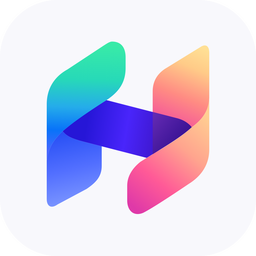
</p>

<h1 align="center">HiHana Evo</h1>

<p align="center">
  <b>하나고등학교 생활을 위한 크로스 플랫폼 컴패니언</b><br>
  AI가 게시글을 요약하고 일정을 뽑아 매일 아침 브리핑으로 — 시간표·급식·좌석·외출 신청까지 앱 하나로
</p>

<p align="center">
  <a href="https://github.com/Kyoohan/hihana-neo/releases/latest"></a>
  <a href="#install"></a>
  <a href="#install"></a>
  <a href="https://github.com/Kyoohan/hihana-neo/releases"></a>
</p>

<p align="center">
  <a href="#ai">AI 기능</a> ·
  <a href="#features">주요 기능</a> ·
  <a href="#tablet">태블릿</a> ·
  <a href="#install">설치</a> ·
  <a href="#privacy">개인정보</a> ·
  <a href="https://github.com/Kyoohan/hihana-neo/releases">변경 사항</a> ·
  <a href="#structure">저장소 구성</a>
</p>

> [!NOTE]
> 하나고 학생이 만든 비공식 앱입니다. 학교가 운영하는 앱이 아니며, 학교 학사시스템(하이하나) 계정으로 로그인해 그 정보를 보기 쉽게 정리해 보여 줍니다.

<a id="ai"></a>
## ✨ AI가 먼저 읽어 줍니다

공지는 많고 마감은 글 속에 숨어 있습니다. HiHana Evo는 새 게시글을 생성형 AI로 요약하고, 글에 적힌 마감·행사 날짜를 찾아 일정에 올리고, 아침마다 그날 챙길 것을 브리핑으로 정리합니다.

<table>
  <tr>
    <td align="center" valign="top" width="25%">
      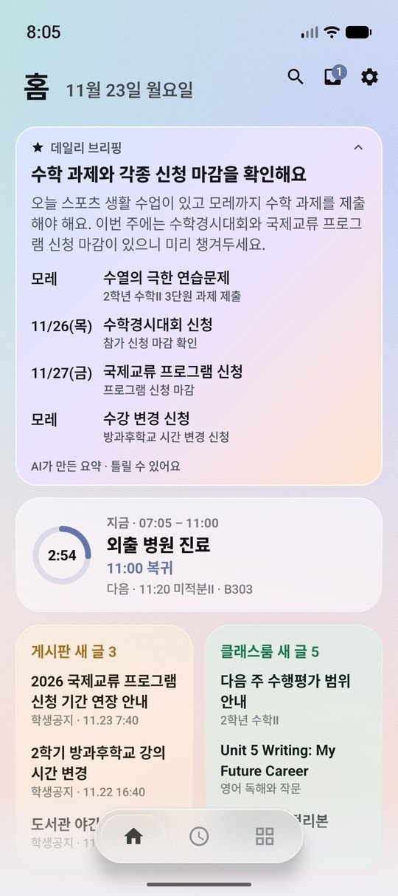<br>
      <b>데일리 브리핑</b><br>
      <sub>오늘 수업과 이번 주 마감·시험을 AI가 한 단락으로 정리하고, 꼭 챙길 일정을 날짜와 함께 골라 줍니다.</sub>
    </td>
    <td align="center" valign="top" width="25%">
      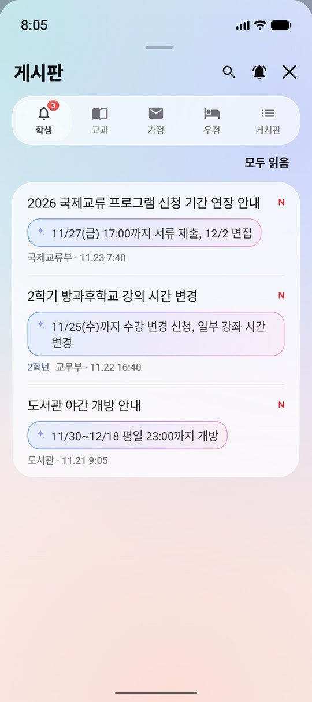<br>
      <b>게시글 한 줄 요약</b><br>
      <sub>목록에서 글마다 마감·장소·대상을 한 줄로. 열어 보지 않아도 무슨 글인지 압니다.</sub>
    </td>
    <td align="center" valign="top" width="25%">
      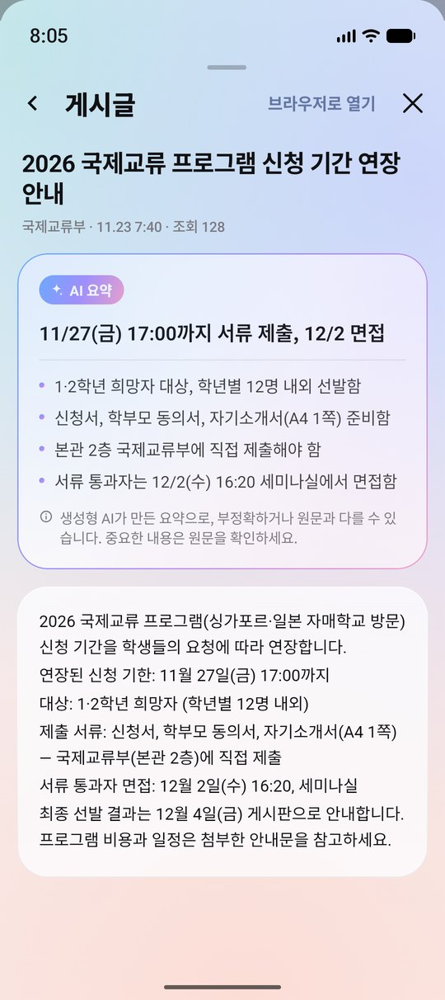<br>
      <b>AI 요약 카드</b><br>
      <sub>글을 열면 핵심 한 줄과 챙길 것들을 글머리표로. 원문은 그 아래 그대로 있습니다.</sub>
    </td>
    <td align="center" valign="top" width="25%">
      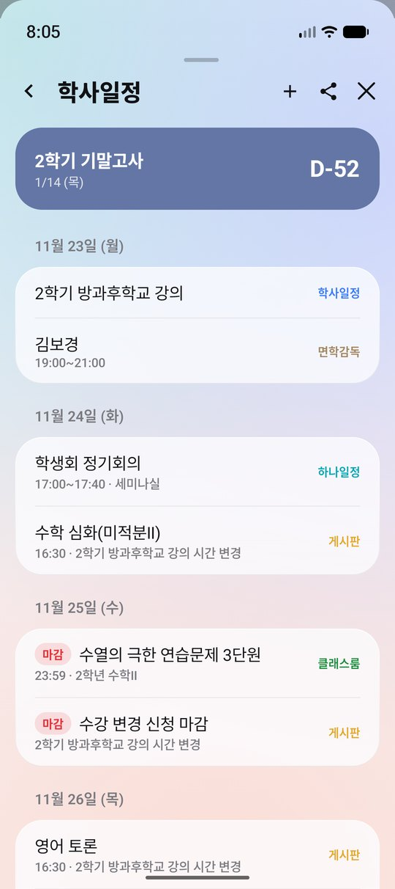<br>
      <b>게시글에서 뽑은 일정</b><br>
      <sub>글 속 마감·행사·면접 날짜를 AI가 찾아 학사일정과 한 목록에 올립니다(노란 '게시판' 표시).</sub>
    </td>
  </tr>
</table>

<a id="features"></a>
## 📱 매일 쓰는 화면

<table>
  <tr>
    <td align="center" valign="top" width="25%">
      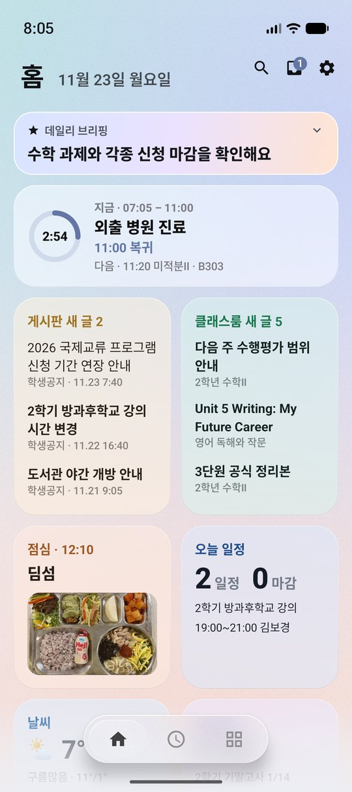<br>
      <b>홈</b><br>
      <sub>지금 하는 것과 남은 시간, 다음 일정. 시간에 맞춰 급식·게시판·클래스룸 칸이 자리를 바꿉니다.</sub>
    </td>
    <td align="center" valign="top" width="25%">
      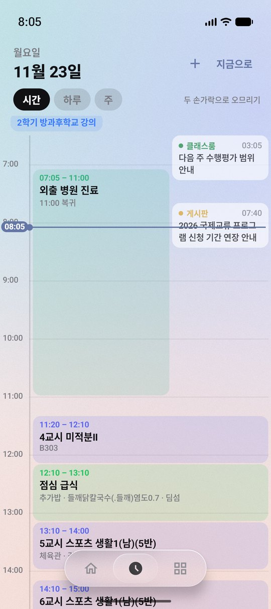<br>
      <b>타임라인</b><br>
      <sub>수업·면학·급식·외출을 시각순 한 줄로, 그 시간의 게시판·클래스룸 글을 옆에. 시간·하루·주 단위.</sub>
    </td>
    <td align="center" valign="top" width="25%">
      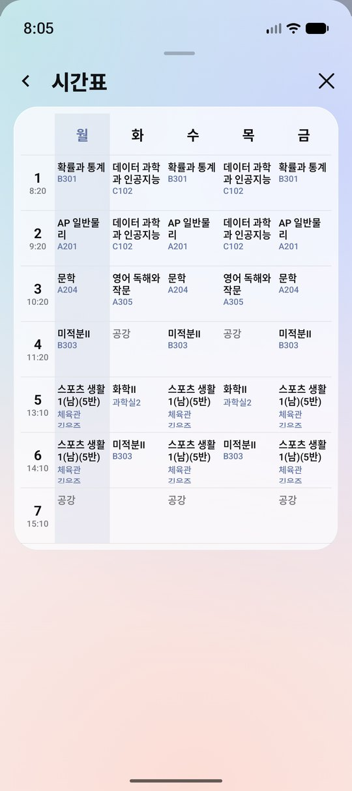<br>
      <b>시간표</b><br>
      <sub>이번 주 시간표와 교시별 시각·교실. 공강도 한눈에.</sub>
    </td>
    <td align="center" valign="top" width="25%">
      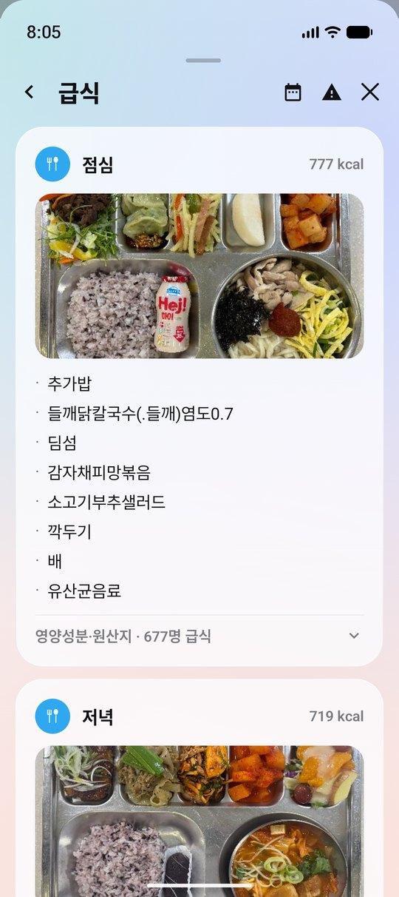<br>
      <b>급식</b><br>
      <sub>아침·점심·저녁·간식과 급식 사진, 칼로리, 알레르기 표시.</sub>
    </td>
  </tr>
</table>

## 🏫 학교 생활

<table>
  <tr>
    <td align="center" valign="top" width="25%">
      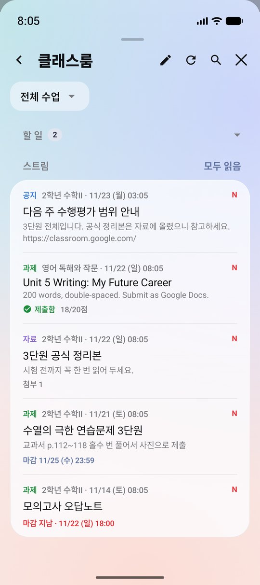<br>
      <b>구글 클래스룸</b><br>
      <sub>학교 계정으로 한 번 허용하면 공지·과제·자료와 제출 상태, 다가오는 마감.</sub>
    </td>
    <td align="center" valign="top" width="25%">
      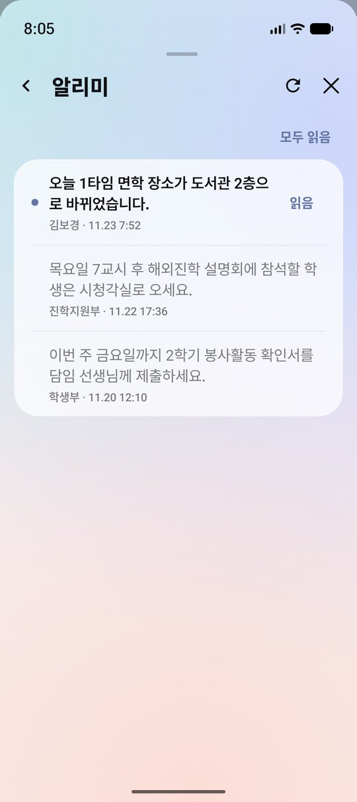<br>
      <b>알리미</b><br>
      <sub>선생님이 보낸 알리미를 읽음 표시와 함께. 새 알리미는 알림으로.</sub>
    </td>
    <td align="center" valign="top" width="25%">
      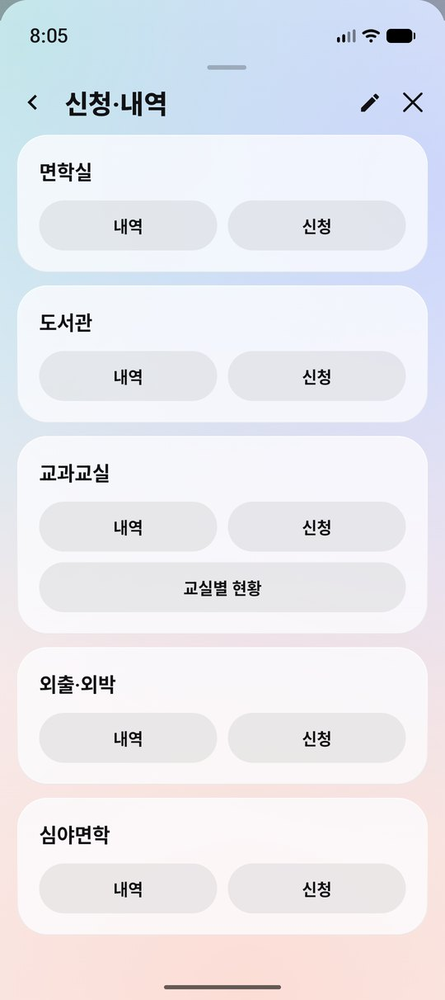<br>
      <b>신청·내역</b><br>
      <sub>면학실·도서관 좌석, 교과교실, 외출·외박, 심야면학 신청과 내역을 한곳에.</sub>
    </td>
    <td align="center" valign="top" width="25%">
      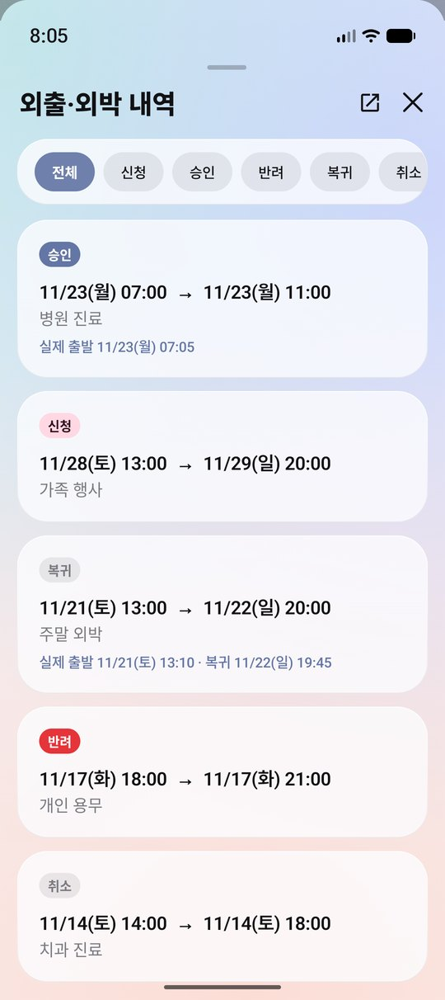<br>
      <b>외출·외박 내역</b><br>
      <sub>신청·승인·반려·복귀를 상태별로. 승인되거나 반려되면 바로 알림.</sub>
    </td>
  </tr>
</table>

## 🎨 날씨와 꾸미기

<table>
  <tr>
    <td align="center" valign="top" width="25%">
      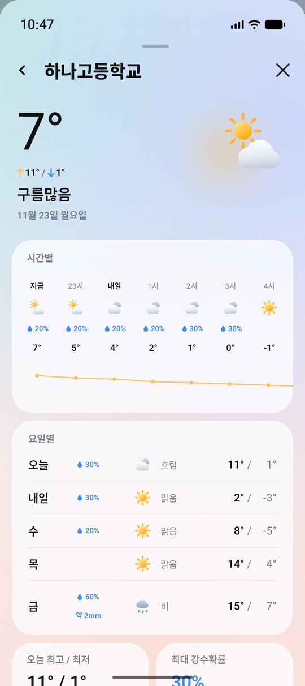<br>
      <b>날씨</b><br>
      <sub>학교 날씨의 시간별·요일별 예보, 귀가 기간엔 서울 날씨와 귀교 시각.</sub>
    </td>
    <td align="center" valign="top" width="25%">
      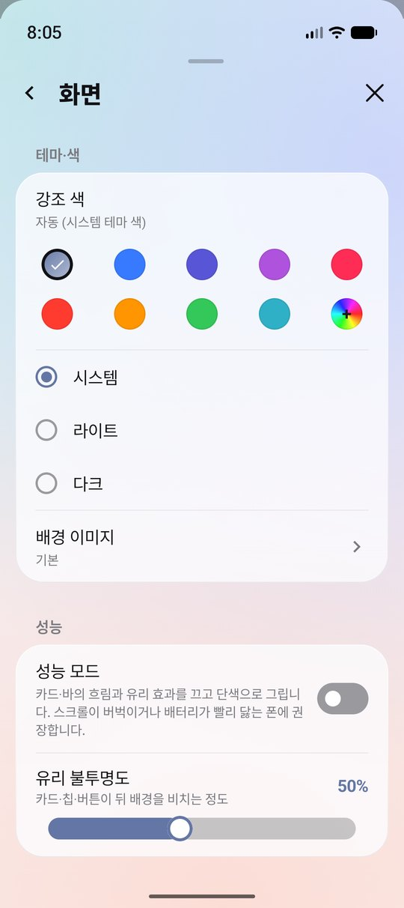<br>
      <b>화면</b><br>
      <sub>라이트·다크, 강조색, 배경 사진과 유리 불투명도.</sub>
    </td>
    <td align="center" valign="top" width="25%">
      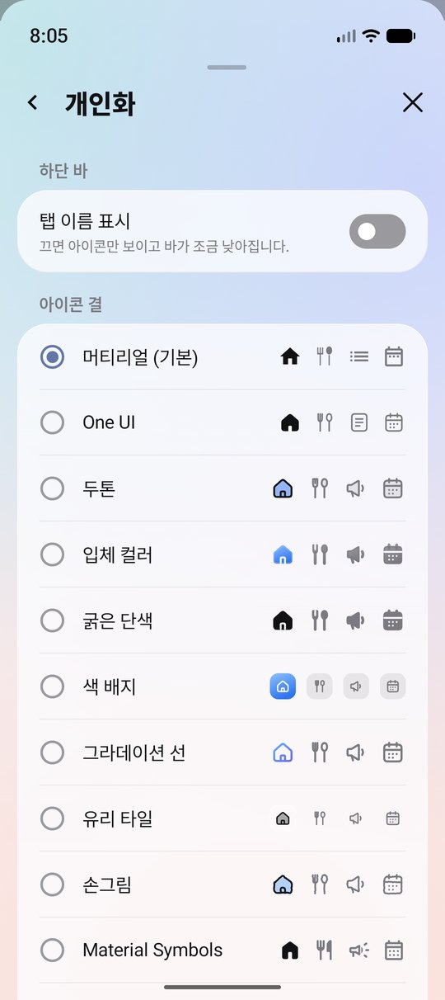<br>
      <b>개인화</b><br>
      <sub>아래 탭 막대와 아이콘 결을 취향대로.</sub>
    </td>
  </tr>
</table>

홈 화면 위젯과 안드로이드 Now Bar·아이폰 실시간 활동에서도 지금 수업과 남은 시간을 볼 수 있습니다.

<a id="tablet"></a>
## 🖥️ 태블릿·아이패드

넓은 화면에서는 사이드바와 목록 | 본문 두 칸으로 바뀝니다. 게시판에서 글을 고르면 옆 칸에 AI 요약과 본문이 바로 뜹니다.

<p align="center">
  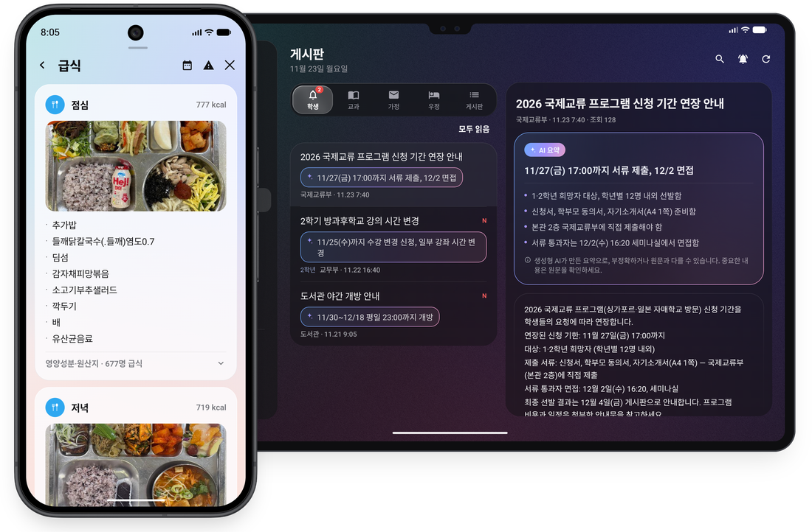
  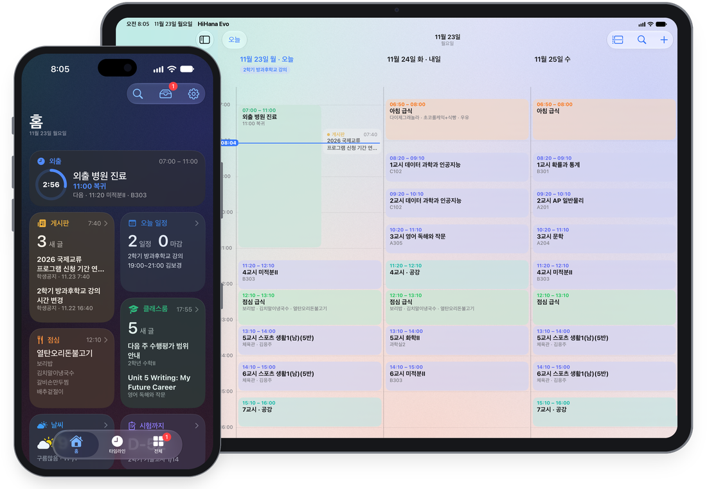
</p>

<sub>스크린샷은 안드로이드 앱의 예시 데이터(데모 모드)로 찍었습니다. 게시글·일정·시간표는 지어낸 예시이고, 급식과 날씨는 그날의 실제 값, AI 요약·브리핑은 예시 글을 요약 서버에 실제로 보내 받은 결과입니다.</sub>

<a id="install"></a>
## 📲 설치

| 기기 | 받는 곳 | 설치 방법 |
| --- | --- | --- |
| **안드로이드** 폰·태블릿 | [최신 릴리스](https://github.com/Kyoohan/hihana-neo/releases/latest)의 `hihana-neo-<버전>.apk` | 파일을 열어 설치합니다. 처음 한 번 '출처를 알 수 없는 앱 설치'를 허용해야 합니다. 이후 업데이트는 앱 안에서 바로 받습니다. |
| **아이폰·아이패드** | [최신 릴리스](https://github.com/Kyoohan/hihana-neo/releases/latest)의 `hihana-neo-<버전>-ios.ipa` | [SideStore](https://sidestore.io)로 설치합니다(무료 Apple ID). 이후 업데이트는 앱 안 **HiHana Evo 정보 › 업데이트**로 받습니다. |

<details>
<summary><b>SideStore 소스로 업데이트 받기 (아이폰·아이패드)</b></summary>

SideStore → **Sources** → **+** 에 아래 주소를 추가하면 SideStore 안에서도 새 버전이 보입니다.

```
https://raw.githubusercontent.com/Kyoohan/hihana-neo/main/ios/source.json
```

무료 Apple ID로 서명한 앱은 7일마다 SideStore에서 **Refresh All**로 갱신해야 합니다.
</details>

<a id="privacy"></a>
## 🔒 개인정보

- 학사시스템 아이디·비밀번호는 **이 기기 안에만 암호화해 저장**합니다(안드로이드 키스토어 / iOS 키체인). 학교 학사시스템 말고는 어디로도 보내지 않습니다.
- AI 요약·일정 추출은 게시글 제목과 본문을, 데일리 브리핑은 그날 수업과 일정 제목을 생성형 AI 요약 서버로 보냅니다. 설정에서 끌 수 있고, 끄면 보내지 않습니다.
- 자세한 내용은 앱 안 **설정 › HiHana Evo 정보 › 개인정보 보호**에 있습니다.

<a id="structure"></a>
## 🗂️ 저장소 구성

| 폴더 | 내용 |
| --- | --- |
| [`android/`](android) | 안드로이드 앱 (Kotlin · Jetpack Compose) |
| [`ios/`](ios) | 아이폰·아이패드 앱 (SwiftUI) — [만들고 실행하기](ios/README.md) |
| [`summary-worker/`](summary-worker) | 게시글 요약·일정 추출·데일리 브리핑·날씨·앱 공지와 클래스룸 중계를 맡는 Cloudflare Worker |
| [`classroom-bridge/`](classroom-bridge) | 구글 클래스룸 연결용 Apps Script |

---

<sub>
Android 로봇 그림은 Google이 만들어 공유한 작품을 <a href="https://creativecommons.org/licenses/by/3.0/">CC BY 3.0</a> 조건에 따라 사용했습니다.
Apple, iPhone, iPad, iOS, iPadOS는 Apple Inc.의 상표이고, Android는 Google LLC의 상표입니다. 이 앱은 Apple·Google·하나고등학교와 관계가 없습니다.
</sub>
