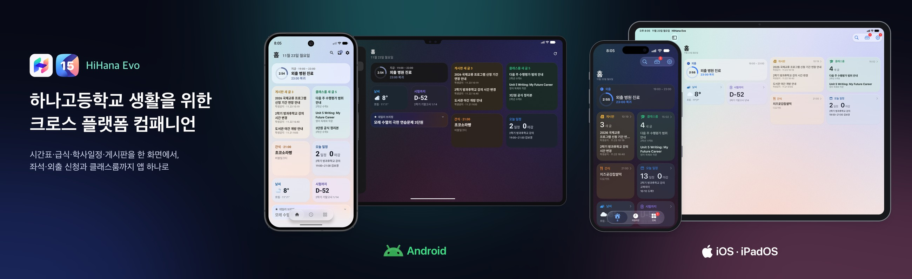

<p align="center">
  
</p>

<p align="center">
  
</p>

<h1 align="center">HiHana Evo</h1>

<p align="center">
  <b>하나고등학교 생활을 위한 크로스 플랫폼 컴패니언</b><br>
  시간표·급식·학사일정·게시판을 한 화면에서, 좌석·외출 신청과 클래스룸까지 앱 하나로
</p>

<p align="center">
  <a href="https://github.com/Kyoohan/hihana-neo/releases/latest"></a>
  
  
  <a href="https://github.com/Kyoohan/hihana-neo/releases"></a>
</p>

<p align="center">
  <a href="#-설치">설치</a> ·
  <a href="#-주요-기능">주요 기능</a> ·
  <a href="#-개인정보">개인정보</a> ·
  <a href="https://github.com/Kyoohan/hihana-neo/releases">변경 사항</a> ·
  <a href="#-저장소-구성">저장소 구성</a>
</p>

> [!NOTE]
> 하나고 학생이 만든 비공식 앱입니다. 학교가 운영하는 앱이 아니며, 학교 학사시스템(하이하나) 계정으로 로그인해 그 정보를 보기 쉽게 정리해 보여 줍니다.

---

## 📲 설치

| 기기 | 받는 곳 | 설치 방법 |
| --- | --- | --- |
| **안드로이드** 폰·태블릿 | [최신 릴리스](https://github.com/Kyoohan/hihana-neo/releases/latest)의 `hihana-neo-<버전>.apk` | 파일을 열어 설치합니다. 처음 한 번 '출처를 알 수 없는 앱 설치'를 허용해야 합니다. 이후 업데이트는 앱 안에서 바로 받습니다. |
| **아이폰·아이패드** | [최신 릴리스](https://github.com/Kyoohan/hihana-neo/releases/latest)의 `hihana-neo-<버전>-ios.ipa` | [SideStore](https://sidestore.io)로 설치합니다(무료 Apple ID). 이후 업데이트는 앱 안 **HiHana Evo 정보 › 업데이트**로 받습니다. |

<details>
<summary><b>SideStore 소스로 업데이트 받기 (아이폰·아이패드)</b></summary>

SideStore → **Sources** → **+** 에 아래 주소를 추가하면 SideStore 안에서도 새 버전이 보입니다.

```
https://raw.githubusercontent.com/Kyoohan/hihana-neo/main/ios/source.json
```

무료 Apple ID로 서명한 앱은 7일마다 SideStore에서 **Refresh All**로 갱신해야 합니다.
</details>

## ✨ 주요 기능

| | |
| --- | --- |
| 🏠 **홈** | 지금 하는 것·있을 곳·남은 시간, 다음 일정. 시간에 맞춰 급식·게시판·클래스룸·오늘 일정 칸이 자리를 바꿉니다. |
| 🕒 **타임라인** | 수업·면학·급식을 시각순 한 줄로, 그 시간의 클래스룸·게시판 글을 옆에. 시간·하루·주 단위로 봅니다. |
| 🍱 **급식** | 아침·점심·저녁·간식, 급식 사진과 알레르기 표시, 특식을 크게. |
| 📅 **학사일정** | 학사일정, 게시판 글 속 날짜, 클래스룸 과제 마감, 내가 직접 넣은 일정을 날짜순 한 목록으로. 시험 D-day와 데일리 브리핑까지. |
| 📰 **게시판·알리미** | 게시판별 새 글 알림과 요약, 하이하나 전체 글 검색, 알리미 읽음 표시. |
| 🎓 **구글 클래스룸** | 학교 계정으로 한 번 허용하면 공지·과제·자료와 제출 상태, 마감이 다가오는 할 일. |
| 🪑 **신청·내역** | 면학실·도서관 좌석 배치도에서 바로 신청, 교과교실·외출·외박 신청과 내역, 심야면학. 외출·외박이 승인·반려되면 알림. |
| 📱 **위젯·실시간 일정** | 홈 화면 위젯, 안드로이드 Now Bar·아이폰 실시간 활동에 남은 시간을 실시간으로. |
| 🌤️ **날씨·귀가** | 학교 날씨, 귀가 기간엔 서울 날씨와 귀교 시각. |
| 🖥️ **태블릿·아이패드** | 넓은 화면에 맞춘 사이드바와 목록 \| 본문 두 칸. |

## 🔒 개인정보

- 학사시스템 아이디·비밀번호는 **이 기기 안에만 암호화해 저장**합니다(안드로이드 키스토어 / iOS 키체인). 학교 학사시스템 말고는 어디로도 보내지 않습니다.
- 게시글 요약·데일리 브리핑은 생성형 AI 요약 서버를 거칩니다. 설정에서 끌 수 있고, 끄면 글을 보내지 않습니다.
- 자세한 내용은 앱 안 **설정 › HiHana Evo 정보 › 개인정보 보호**에 있습니다.

## 🗂️ 저장소 구성

| 폴더 | 내용 |
| --- | --- |
| [`android/`](android) | 안드로이드 앱 (Kotlin · Jetpack Compose) |
| [`ios/`](ios) | 아이폰·아이패드 앱 (SwiftUI) — [만들고 실행하기](ios/README.md) |
| [`summary-worker/`](summary-worker) | 게시글 요약·데일리 브리핑·날씨·앱 공지와 클래스룸 중계를 맡는 Cloudflare Worker |
| [`classroom-bridge/`](classroom-bridge) | 구글 클래스룸 연결용 Apps Script |

---

<sub>
Android 로봇 그림은 Google이 만들어 공유한 작품을 <a href="https://creativecommons.org/licenses/by/3.0/">CC BY 3.0</a> 조건에 따라 사용했습니다.
Apple, iPhone, iPad, iOS, iPadOS는 Apple Inc.의 상표이고, Android는 Google LLC의 상표입니다. 이 앱은 Apple·Google·하나고등학교와 관계가 없습니다.
</sub>
